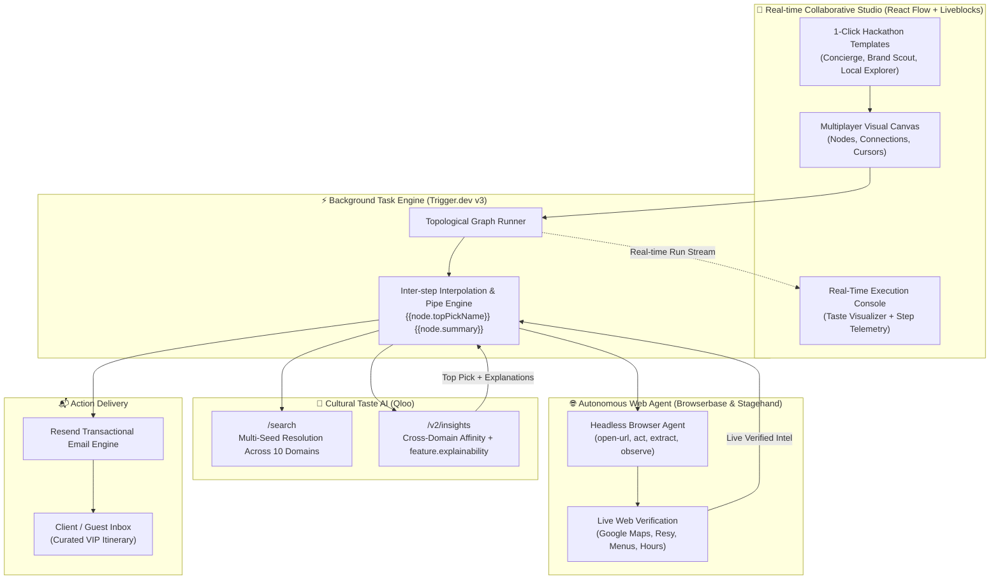

# 🎭 TasteAgent: Autonomous Cultural Concierge & Workflow Builder

> **Qloo Hackathon Submission**  
> *Transforming Qloo’s Cultural Taste Intelligence into Autonomous, Real-World Web Actions.*

[](https://nextjs.org/)
[](https://qloo.com/)
[](https://trigger.dev/)
[](https://browserbase.com/)
[](https://liveblocks.io/)
[](https://neon.tech/)

---

## 🌟 The Big Idea

Most recommendation engines suffer from two fundamental flaws:
1. **The Cold-Start & Bubble Trap:** Generic algorithms guess what you like based purely on single-domain history (e.g. recommending pop songs just because you listened to pop). They lack true **cross-domain cultural intelligence**.
2. **The "Last-Mile Gap":** Traditional AI only gives passive text suggestions (*"Here are 3 bars you might like"*). The user is still forced to manually Google the venues, check if they are open tonight, browse menus, hunt for reservations, and email their friends.

**TasteAgent solves both.**

By uniting **Qloo's Cultural Taste Graph** with **Browserbase & Stagehand's autonomous browser agents**, **Liveblocks multiplayer canvas**, and **Trigger.dev orchestration**, TasteAgent transforms taste intelligence into **executable real-world action**.

---

## 🏗️ System Architecture



---

## ✨ Key Features

### 1. 🧠 Full Qloo Cultural Graph Integration
- **Multi-Seed Resolution**: Query multiple favorites simultaneously (e.g., *"Radiohead, Haruki Murakami, Wes Anderson"*).
- **All 10 Official Qloo Domains Supported**:
  - `urn:entity:artist` (Musicians & Bands)
  - `urn:entity:place` (Restaurants, Bars, Speakeasies, Hotels)
  - `urn:entity:movie` (Films & Cinema)
  - `urn:entity:tv_show` (Television Series)
  - `urn:entity:book` (Literature & Authors)
  - `urn:entity:brand` (Fashion & Lifestyle Brands)
  - `urn:entity:podcast` (Podcasts)
  - `urn:entity:video_game` (Games)
  - `urn:entity:destination` (Cities & Travel Hotspots)
  - `urn:entity:person` (Creators & Public Figures)

### 2. 🔍 Transparent Explainability (`feature.explainability`)
- Requests to Qloo's `/v2/insights` automatically pass `feature.explainability=true`.
- Extracts and surfaces why Qloo connected each entity (e.g., *"94% cultural affinity match with your taste seeds in places"*).
- Direct exposure of `topPickReason` for personalized messaging.

### 3. 🤖 Autonomous Web Agents (Stagehand + Browserbase)
- Dispatches cloud browsers that dynamically navigate to live search results for Qloo's top picks.
- Extracts live operating hours, reservation availability, reviews, and event schedules without manual human intervention.

### 4. 👥 Multiplayer Real-Time Canvas (Liveblocks)
- Work with friends or team members on the same canvas in real time.
- See active cursors, presence avatars, and live workflow modifications instantly.

### 5. 📊 Interactive Taste Visualizer Console
- Live step-by-step execution stream powered by Trigger.dev.
- Custom **Taste Intelligence Cards** displaying affinity percentage badges, top pick spotlights, formatted itineraries, and one-click toggle to Raw JSON.

---

## 🚀 Pre-Wired Hackathon Templates

Open the canvas sidebar and click any template under **Qloo Hackathon Templates** to load a ready-to-run pipeline:

| Template Name | Pipeline Flow | Target Use Case |
|---|---|---|
| **Autonomous Cultural Concierge** | `Start` ➔ `Qloo Taste Seeds` ➔ `Tokyo Local Discovery` ➔ `Autonomous Web Verification` ➔ `Deliver VIP Itinerary Email` | Complete end-to-end autonomous concierge trip planner |
| **Cross-Domain Taste Scout** | `Start` ➔ `Aesthetic Cinema Seeds` ➔ `Aligned Lifestyle Brands` ➔ `Deliver Brand Affinity Digest Email` | B2B brand sponsorship & aesthetic trend scouting |
| **Local Places Explorer** | `Start` ➔ `Favorite Artist Seed` ➔ `New York City Nightlife Discovery` | Rapid local cultural venue curation |

---

## 🛠️ Step Nodes Reference

| Node | Type | Description | Key Outputs Available for Chaining |
|---|---|---|---|
| **Qloo Taste Seeds** | Action | Resolves cultural favorites into Qloo entity URNs. Supports multi-seed queries. | `entityIds`, `primaryEntityId`, `primaryName`, `names`, `summary` |
| **Qloo Recommendations** | Action | Generates cross-domain recommendations with explainability and optional city filter. | `topPickName`, `topPickReason`, `searchQuery`, `summary`, `names`, `entities` |
| **Qloo Local Discovery** | Action | Discovers hyper-local venues (bars, clubs, restaurants) in a specified city. | `topPickName`, `topPickReason`, `searchQuery`, `summary`, `entities` |
| **Open URL** | Action | Directs the Browserbase cloud browser to any URL. | `url`, `title` |
| **Act (Stagehand)** | Action | Executes autonomous browser actions via natural language instructions. | `success`, `message`, `url` |
| **Extract (Stagehand)** | Action | Scrapes structured data from the active web page. | `data` |
| **Send Email (Resend)** | Action | Dispatches customized emails with dynamic interpolation. | `id` |

---

## 💻 Tech Stack

- **Framework**: [Next.js 16](https://nextjs.org/) (App Router, Server Actions, React 19)
- **Cultural AI**: [Qloo Taste AI API](https://docs.qloo.com/) (`/search`, `/v2/insights`)
- **Visual Canvas**: [@xyflow/react](https://reactflow.dev/) (React Flow)
- **Multiplayer State**: [Liveblocks](https://liveblocks.io/) (`@liveblocks/react-flow`, `@liveblocks/client`)
- **Workflow Orchestration**: [Trigger.dev v3](https://trigger.dev/) (Real-time run streaming, durability)
- **Browser Automation**: [Browserbase](https://www.browserbase.com/) & [Stagehand](https://github.com/browserbase/stagehand)
- **Database & ORM**: [Neon Serverless Postgres](https://neon.tech/) & [Drizzle ORM](https://orm.drizzle.team/)
- **Auth**: [Clerk](https://clerk.com/)
- **Styling & UI**: Tailwind CSS v4, Radix UI, shadcn/ui, Lucide Icons

---

## ⚙️ Quick Start & Setup

### 1. Clone the repository
```bash
git clone https://github.com/your-username/taste-agent.git
cd taste-agent
```

### 2. Install dependencies
```bash
npm install
```

### 3. Environment Variables
Create a `.env` file in the project root:

```env
# Database
DATABASE_URL=postgresql://...

# Qloo Taste Intelligence
QLOO_API_KEY=your_qloo_hackathon_api_key
QLOO_BASE_URL=https://hackathon.api.qloo.com

# Trigger.dev
TRIGGER_SECRET_KEY=tr_dev_...

# Browserbase & Stagehand (Autonomous Web Agents)
BROWSERBASE_API_KEY=...
BROWSERBASE_PROJECT_ID=...

# Resend (Email Deliveries)
RESEND_API_KEY=re_...

# Liveblocks (Multiplayer Canvas)
LIVEBLOCKS_SECRET_KEY=sk_...
NEXT_PUBLIC_LIVEBLOCKS_PUBLIC_KEY=pk_...

# Clerk Authentication
NEXT_PUBLIC_CLERK_PUBLISHABLE_KEY=pk_...
CLERK_SECRET_KEY=sk_...
```

### 4. Push Database Schema
```bash
npm run db:push
```

### 5. Run Development Servers
In terminal 1 (Next.js app):
```bash
npm run dev
```

In terminal 2 (Trigger.dev background worker):
```bash
npx trigger.dev@latest dev
```

Visit `http://localhost:3000` to create workflows and run autonomous cultural agents!

---

## 🏆 Devpost Submission Summary

### Inspiration
Human taste is nuanced and multi-dimensional. A fan of Radiohead and Haruki Murakami doesn't just listen to similar bands—they have predictable affinities for specific types of boutique hotels, quiet jazz listening bars, indie clothing brands, and arthouse cinema. Qloo unlocked this cultural graph, and we wanted to bridge this "taste intelligence" with autonomous web agents to build the ultimate proactive cultural concierge.

### What We Learned
- **Cross-domain correlation is vastly superior to single-domain recommendation:** Recommending a restaurant based on someone's literary and musical preferences creates delightful, serendipitous experiences that standard recommendation engines cannot replicate.
- **Explainability builds user trust:** Using `feature.explainability` turns black-box recommendations into compelling narratives that users love reading.

### What's Next
- **Multi-user Taste Compromise node**: Blending taste profiles from multiple Liveblocks room participants into a consensus itinerary.
- **Direct Autonomous Booking**: Enabling Stagehand to complete OpenTable / Resy checkout flows securely with user confirmation.
